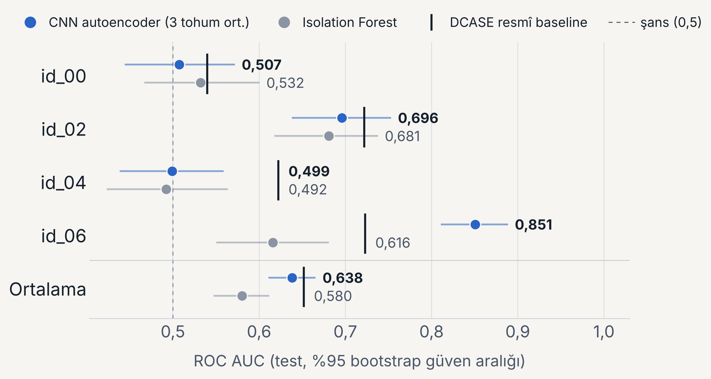
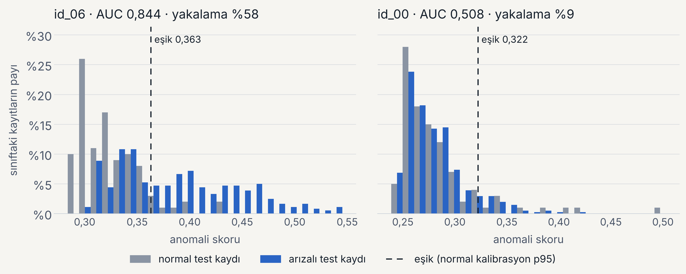

# Sesten Makine Arıza Tespiti: CNN Autoencoder ile Isolation Forest Karşılaştırması

**BMT448 Derin Öğrenmeye Giriş — Dönem Projesi**

Ömer Faruk Aşkın (23181616758) · \[Ekip arkadaşının adı ve numarası\] · 21 Kasım 2026

## Özet

Bu çalışmada endüstriyel fan seslerinden, arızalı örnek görmeden arıza (anomali) tespiti ele alınmıştır. DCASE 2020 Görev 2 geliştirme setinin fan alt kümesinde (4 makine kimliği, 5.550 kayıt), yalnızca normal kayıtlarla eğitilen iki yöntem karşılaştırılmıştır: log mel istatistikleri üzerinde Isolation Forest ve 64 × 64 log mel pencereleri üzerinde küçük bir evrişimli autoencoder (CNN AE).

Karar eşiği, arızalı örnek kullanılmadan normal kalibrasyon kayıtlarının 95. persentilinden seçilmiştir. Testte CNN AE, kimliklerin ortalamasında ROC AUC 0,638 (üç tohum) ile Isolation Forest'ın 0,580 değerini geçmiştir; fark +0,058'dir (%95 GA \[0,036; 0,081\]). Farkın neredeyse tamamı id\_06'dan gelir (0,851'e karşı 0,616); id\_00 ve id\_04'te iki yöntem de şans düzeyindedir.

Testte yanlış alarm oranı ortalamada %6,1 ile %5 hedefine yakın kalmış, ancak eşik anomalilerin yalnızca %22'sini yakalamıştır. +20 ve +10 dB beyaz gürültü AUC'yi düşürmemiş, sabit eşikte ise yanlış alarm ve yakalama oranını azaltmıştır; eşiği gürültülü normal kayıtlarla yeniden kalibre etmek bu kaymayı büyük ölçüde gidermiştir.

**Anahtar kelimeler:** anomali tespiti, makine sesi, evrişimli autoencoder, Isolation Forest, DCASE 2020

## 1. Giriş

Makine arızaları çoğu zaman önce sese yansır: dengesizlik, gevşeme veya tıkanma, normal çalışma sesinde küçük değişiklikler yaratır. Bu değişiklikleri erken yakalamak, bakımın arıza olmadan planlanmasını sağlar.

Zorluk, arızalı ses örneklerinin az ve çok çeşitli olmasıdır. Her arıza türünü önceden kaydetmek mümkün değildir. Bu yüzden model yalnızca normal seslerle eğitilir ve normalden sapan sesler anomali sayılır. Bu kurulum, DCASE 2020 Görev 2'deki denetimsiz anomali tespiti problemiyle aynıdır \[1\].

**Araştırma sorusu:** Küçük bir evrişimli autoencoder (CNN AE), basit istatistiklere dayalı Isolation Forest referansını geçiyor mu ve kayda eklenen beyaz gürültü başarıyı ne kadar düşürüyor?

**Katkılar:**

1. Kayıt düzeyinde bölünmüş, sızıntısız ve tekrarlanabilir bir değerlendirme hattı.
2. İki yöntemin aynı bölünmede ve aynı test kayıtlarında karşılaştırılması.
3. Karar eşiğinin yalnızca normal kalibrasyon kayıtlarından seçilmesi ve yanlış alarm oranının güven aralığıyla raporlanması.
4. Ek gürültünün etkisinin sıralama gücü (AUC) ve eşik kayması olarak ayrı ayrı incelenmesi.

**Kapsam sınırı:** Sistem ses anomalisini saptar; arızanın nedenini veya kalan ömrü tahmin etmez. Anomali skoru kalibre edilmiş bir arıza olasılığı değildir.

## 2. İlgili Çalışmalar

Makine sesinde anomali tespitinde yaygın yaklaşım, yalnızca normal veriden bir model öğrenip yeni kaydın bu modelden sapmasını ölçmektir \[1, 4\]. Derin ve sığ yöntemlerin karşılaştırmalı bir derlemesi \[5\]'te verilmiştir.

**Veri setleri.** MIMII, fan, pompa, vana ve kızaklı ray gibi endüstriyel makinelerin normal ve arızalı seslerini fabrika gürültüsüyle birlikte kaydeder \[2\]. ToyADMOS, minyatür makinelerle benzer kayıtlar sunar \[3\]. DCASE 2020 Görev 2 bu iki kaynaktan altı makine türünü ortak bir düzende birleştirmiştir \[1\].

**Yeniden oluşturma yaklaşımları.** Autoencoder, girdiyi dar bir temsile sıkıştırıp geri üretmeyi öğrenir \[6\]. Normal veriyle eğitilen bir autoencoder'ın alışılmadık girdilerde daha yüksek hata vermesi beklenir. Görevin resmî baseline'ı da ardışık log mel çerçevelerini yeniden oluşturan tam bağlantılı bir autoencoder kullanır \[1\].

Evrişimli autoencoder'lar spektrogramdaki yerel zaman-frekans örüntülerini daha az parametreyle modeller \[7\]. IDNN ise bir çerçeve dizisinin ortasındaki çerçeveyi kenarlardan tahmin ederek kenar çerçevelerin kolay yeniden üretilmesi sorununu azaltır \[8\].

**Sınıflandırma tabanlı yaklaşımlar.** DCASE 2020'de en iyi sonuç veren yaklaşımlardan biri, normal veride makine kimliklerini ayırt eden bir sınıflandırıcıyı yardımcı görev olarak eğitmiştir \[9\]. Bu yöntem kimlikler arası karşılaştırmaya dayandığı için bu projenin kapsamı dışında tutulmuştur.

**Sığ yöntemler.** Isolation Forest, rastgele bölmelerle bir örneği yalıtmak için gereken ortalama derinliği skor olarak kullanır \[10\]. Az veriyle hızlı çalışır ve ayarı kolaydır; bu yüzden derin modelin ek faydasını ölçmek için uygun bir referanstır.

Bu çalışmanın amacı DCASE sıralamasıyla yarışmak değildir. Amaç, küçük bir derin modeli güçlü bir sığ referansla aynı protokolde ve sızıntısız bir bölünmede adil biçimde karşılaştırmaktır.

## 3. Veri Seti

Deneylerde DCASE 2020 Görev 2 geliştirme setinin fan alt kümesi kullanıldı: 4 makine kimliği ve 5.550 kayıt; her kayıt 10 saniye, 16 kHz ve tek kanaldır \[1, 18\].

Kayıtlar MIMII veri setinden hazırlanmıştır ve fabrika ortam gürültüsü içerir \[2\]. Resmî eğitim klasöründe yalnızca normal kayıtlar (3.675), test klasöründe ise 400 normal ve 1.475 arızalı kayıt bulunur. Veri seti CC BY-NC-SA 4.0 lisansıyla dağıtılır.

| Kimlik | Eğitim | Doğrulama | Kalibrasyon | Test normal | Test anomali |
| --- | --- | --- | --- | --- | --- |
| id\_00 | 638 | 137 | 136 | 100 | 407 |
| id\_02 | 641 | 137 | 138 | 100 | 359 |
| id\_04 | 653 | 140 | 140 | 100 | 348 |
| id\_06 | 640 | 137 | 138 | 100 | 361 |
| Toplam | 2.572 | 551 | 552 | 400 | 1.475 |

*Tablo 1. Kimlik başına kayıt sayıları (bölünme sonrası). Eğitim, doğrulama ve kalibrasyon yalnızca normal kayıt içerir.*

Veri kalitesi kontrolünde tüm dosyalar okunabildi; hepsi 16 kHz, tek kanal ve tam 10,0 saniyedir. Sessiz, kısa veya aynı içerikli kopya dosya bulunmadı ve bölümler arası sızıntı kontrolü geçti.

Test kümesi dengesizdir: her kimlikte arızalı kayıt sayısı normalin 3,5 ile 4 katıdır. Kimlik başına yalnızca 100 normal test kaydı olduğundan tek bir yanlış alarm, yanlış alarm oranını 1 puan değiştirir.

## 4. Yöntem

İki yöntem de aynı log mel spektrogramdan beslenir ve kararı aynı kalibrasyon kuralı verir; yalnızca anomali skorunu üreten model farklıdır (Şekil 1).

*Şekil 1. Yöntemin akışı: ortak log mel ön işleme, iki skor yolu (Isolation Forest ve CNN AE) ve ortak kalibrasyon eşiği. Diyagram, raporun çevrimiçi sürümündedir.*

### 4.1 Ön işleme

Ses tek kanal okunur ve gerekirse 16 kHz'e yeniden örneklenir. Kayıt başına genlik normalizasyonu yapılmaz, çünkü ses seviyesindeki fark arızayla ilişkili olabilir.

Log mel spektrogram librosa \[15\] ile şu ayarlarla çıkarılır: 1024 örneklik (64 ms) Hann penceresi, 512 örneklik (32 ms) kayma, 0–8 kHz arasında 64 mel bandı, güç spektrumu ve desibele çevirme (ref = 1, top\_db = 80). 10 saniyelik bir kayıt 64 × 313 boyutlu bir matris verir.

### 4.2 Referans yöntem: Isolation Forest

Her kayıt için 64 bandın zaman boyunca ortalaması ve standart sapması birleştirilerek 128 boyutlu bir vektör elde edilir. Vektörler eğitim kayıtlarında öğrenilen bir standart ölçekleyiciyle ölçeklenir. 200 ağaçlı Isolation Forest \[10\] (scikit-learn \[17\], random\_state = 42) yalnızca normal eğitim vektörleriyle eğitilir.

Anomali skoru, scikit-learn'ün `score_samples` çıktısının negatifidir; yüksek skor daha anormal demektir.

### 4.3 CNN autoencoder

Model girdisi 64 mel bandı × 64 zaman adımlık (yaklaşık 2 s) pencerelerdir. Pencereler 32 adım kayarak alınır; son pencere doldurma yapılmadan kaydın son 64 adımından alınır ve 10 saniyelik kayıt 9 pencere verir. Her mel bandı, yalnızca eğitim kayıtlarından hesaplanan ortalama ve standart sapmayla ölçeklenir.

| Katman | Çıkış boyutu |
| --- | --- |
| Girdi | 1 × 64 × 64 |
| Conv2d 1→16, çekirdek 3, adım 2, ReLU | 16 × 32 × 32 |
| Conv2d 16→32, çekirdek 3, adım 2, ReLU | 32 × 16 × 16 |
| Conv2d 32→64, çekirdek 3, adım 2, ReLU | 64 × 8 × 8 |
| Linear 4096→128 (darboğaz) | 128 |
| Linear 128→4096, ReLU | 64 × 8 × 8 |
| ConvTranspose2d 64→32, çekirdek 4, adım 2, ReLU | 32 × 16 × 16 |
| ConvTranspose2d 32→16, çekirdek 4, adım 2, ReLU | 16 × 32 × 32 |
| ConvTranspose2d 16→1, çekirdek 4, adım 2, aktivasyon yok | 1 × 64 × 64 |

*Tablo 2. CNN autoencoder katmanları ve çıkış boyutları.*

Modelde toplam 1.117.361 eğitilebilir parametre vardır. Son katmanda aktivasyon yoktur, çünkü ölçeklenmiş girdi hem negatif hem pozitif değerler taşır.

Kayıp, girdi ile çıktı arasındaki ortalama karesel hatadır (MSE). Eğitimde Adam \[11\] (öğrenme oranı 0,001), 32'lik mini batch ve en fazla 50 epoch kullanılır. Normal doğrulama kayıtlarının kaybı 7 epoch boyunca iyileşmezse eğitim durur ve en iyi ağırlıklar saklanır.

Doğrulama kaybı kayıt düzeyinde hesaplanır: pencere hataları önce kayıt içinde, sonra kayıtlar arasında ortalanır. Her fan kimliği için aynı mimari ayrı eğitilir. Uygulama PyTorch \[16\] ile yazılmıştır ve eğitimden önce 20 kayıtla aşırı öğrenme testinden geçirilmiştir.

### 4.4 Kayıt skoru ve karar eşiği

CNN AE'de bir kaydın skoru, pencerelerin yeniden oluşturma hatalarının ortalamasıdır; bu kural testten önce sabitlenmiştir. Her yöntem ve kimlik için eşik, normal kalibrasyon kayıtlarının skorlarının 95. persentilidir.

Skor eşiği aşarsa karar "anomali şüphesi" olur. Bu kural kalibrasyon verisinde yaklaşık %5 yanlış alarm hedefler; testte aynı oranın korunması garanti değildir.

## 5. Deney Düzeni

Tüm ayarlar test sonucuna bakılmadan sabitlendi ve son test bir kez çalıştırıldı; her test çalıştırması kodda bir erişim günlüğüne yazılır.

### 5.1 Veri bölünmesi

| Bölüm | Kaynak | Pay | Ne için |
| --- | --- | --- | --- |
| Eğitim | Resmî train, normal | %70 | Model ağırlıkları ve ölçekleme istatistikleri |
| Doğrulama | Resmî train, normal | %15 | Erken durdurma |
| Kalibrasyon | Resmî train, normal | %15 | Karar eşiği |
| Son test | Resmî test, normal ve anomali | Tamamı | Raporlanan ölçütler |

*Tablo 3. Veri bölümleri ve kullanım amaçları.*

Bölünme her fan kimliği içinde, tohum 42 ile ve pencerelemeden önce kayıt düzeyinde yapılır; pencereler kaydının bölümünü miras alır. Aynı ses içeriğine sahip kopya dosyalar aynı bölüme konur ve resmî testteki bir kaydın eğitim tarafındaki kopyası dışlanır. Oturum bilgisi olmadığından bu bölünme bağımsız kayıt oturumlarını garanti etmez.

### 5.2 Model seçimi

Model seçimi etiketsizdir: erken durdurma yalnızca normal doğrulama kaybına bakar, ön işleme ve mimari ayarları ise önceden sabitlenmiştir. Arızalı kayıtlar eğitimde, model seçiminde ve eşik seçiminde kullanılmaz.

### 5.3 Ölçütler

- **ROC AUC:** eşikten bağımsız sıralama gücü; sürekli skorlardan hesaplanır \[13\].
- **pAUC:** yanlış alarm oranı 0 ile 0,1 arasındaki kısımda ROC alanı; McClish düzeltmesiyle standartlaştırılmış değer \[12, 17\].
- **Precision, recall, F1:** dondurulmuş eşikteki karar başarısı.
- **Yanlış alarm oranı:** FP / (FP + TN), yani normal kayıtların ne kadarının yanlış işaretlendiği.

Ölçütler kimlik başına hesaplanır, sonra kimliklerin eşit ağırlıklı ortalaması alınır. Kimlik başına test normal kayıt sayısı küçük olduğu için %95 güven aralıkları sınıf içi bootstrap ile (1000 tekrar) verilir \[14\]. CNN AE üç farklı tohumla (42, 43, 44) eğitilir ve ortalama ± standart sapma raporlanır. Tohum ortalamalı AUC ile yöntemler arası farkın güven aralıkları ise eşleştirilmiş sınıf içi bootstrap ile (2000 tekrar) hesaplanır; her tekrarda aynı test kayıtları iki yönteme birlikte örneklenir.

### 5.4 Gürültü deneyi

Aynı test kayıtlarına +20 dB ve +10 dB SNR'de beyaz gürültü eklenir; gürültünün RMS değeri kaydın RMS değerinin 0,1 ve yaklaşık 0,316 katıdır. Gürültü sabit tohumla ve dosya başına aynı üretilir, böylece iki yöntem aynı gürültülü kaydı görür. Model ve eşik değişmez.

Ek bir koşulda eşik, aynı SNR'de gürültü eklenmiş normal kalibrasyon kayıtlarından yeniden hesaplanır. Bu koşul, başarı düşüşünün ne kadarının sıralama gücünden, ne kadarının eşik kaymasından geldiğini ayırır. Kayıtlar zaten fabrika gürültüsü içerdiğinden bu deney ek sentetik gürültüye duyarlılığı ölçer.

### 5.5 Tekrarlanabilirlik

Tüm ayarlar tek bir yapılandırma dosyasındadır ve bölünme sabit bir CSV dosyası olarak saklanır. Her eğitim ve kalibrasyon adımı; çalıştırma kimliği, git commit, tohum, süre, en iyi epoch, doğrulama kaybı ve eşikle bir deney defterine yazılır. Deneyler bir MacBook Pro'da (Apple Silicon) yalnızca CPU ile çalıştırılmıştır. Veri hazırlığından gürültü deneyine kadar tüm hat yaklaşık 24 dakika sürmüştür; bunun yaklaşık 21 dakikası üç tohumluk CNN AE eğitimidir (kimlik başına 85–135 s). Kullanılan sürümler: Python 3.13, PyTorch 2.14.1 \[16\], librosa 1.0.0 \[15\], scikit-learn 1.9.1 \[17\] ve NumPy 2.5.3.

## 6. Sonuçlar

CNN AE, kimliklerin ortalamasında Isolation Forest'tan daha iyi sıraladı, ancak farkın neredeyse tamamı tek bir fandan, id\_06'dan geliyor. Aşağıdaki tüm sayılar tek seferlik son testten alınmıştır; test erişim günlüğünde yalnızca bir kayıt vardır (21.11.2026, git 65ccbac).

### 6.1 Sıralama başarısı (AUC ve pAUC)

*Şekil 2. Kimlik başına test ROC AUC ve %95 bootstrap güven aralıkları (CNN AE: üç tohumun ortalaması); kısa dikey çizgiler DCASE resmî baseline değerleridir [19]. Kaynak: `results/report_stats.json`.*

Eşleştirilmiş bootstrap'e göre AUC farkı yalnızca id\_06'da ve kimlik ortalamasında sıfırı dışlar (Tablo 4). Düşük yanlış alarm bölgesini ölçen pAUC aynı tabloyu verir. id\_04'teki küçük pAUC farkı sıfırı dışlasa da iki yöntemin pAUC'si de 0,5'e yakındır.

Resmî DCASE baseline'ının fan ortalaması 0,652'dir \[19\]. CNN AE ortalamada buna yakındır; id\_06'da daha iyi, id\_04'te ise belirgin biçimde daha kötüdür. İki protokol arasındaki farklar Bölüm 7.2'de tartışılmıştır.

| Kimlik | pAUC (IF) | pAUC (CNN AE) | AUC farkı, AE − IF \[%95 GA\] | pAUC farkı, AE − IF \[%95 GA\] |
| --- | --- | --- | --- | --- |
| id\_00 | 0,490 | 0,491 | −0,025 \[−0,068; 0,020\] | 0,000 \[−0,020; 0,018\] |
| id\_02 | 0,571 | 0,593 | 0,015 \[−0,023; 0,054\] | 0,022 \[−0,022; 0,075\] |
| id\_04 | 0,493 | 0,524 | 0,007 \[−0,039; 0,056\] | 0,031 \[0,012; 0,053\] |
| id\_06 | 0,497 | 0,724 | 0,234 \[0,189; 0,284\] | 0,227 \[0,169; 0,285\] |
| **Ortalama** | **0,513** | **0,583** | **0,058 \[0,036; 0,081\]** | **0,070 \[0,050; 0,090\]** |

*Tablo 4. pAUC (yanlış alarm ≤ 0,1, McClish düzeltmeli) ve eşleştirilmiş bootstrap ile yöntem farkları; CNN AE değerleri üç tohumun ortalamasıdır.*

### 6.2 Eşikli kararlar

Kalibrasyonda %5 hedeflenen yanlış alarm oranı, testte kimlik ortalamasında CNN AE için %6,1, Isolation Forest için %6,25 oldu. Ancak oran kimlikler arasında %1 ile %11 arasında değişti (Tablo 5). Kimlik başına yalnızca 100 normal test kaydı olduğundan bu oranlar belirsizdir; örneğin CNN AE'nin id\_00'daki oranı için tek tohumda %95 güven aralığı \[%5; %17\]'dir.

Eşik, anomalilerin CNN AE'de ortalama %22'sini, Isolation Forest'ta %7'sini yakaladı. CNN AE'nin yakalama oranı id\_06'da %58'e çıkarken diğer üç kimlikte %6 ile %15 arasında kaldı.

| Kimlik | Yanlış alarm (IF / AE) | Recall (IF / AE) | Precision (IF / AE) | F1 (IF / AE) |
| --- | --- | --- | --- | --- |
| id\_00 | 0,100 / 0,113 | 0,101 / 0,093 | 0,804 / 0,770 | 0,179 / 0,167 |
| id\_02 | 0,010 / 0,027 | 0,039 / 0,154 | 0,933 / 0,954 | 0,075 / 0,265 |
| id\_04 | 0,030 / 0,030 | 0,032 / 0,064 | 0,786 / 0,881 | 0,061 / 0,120 |
| id\_06 | 0,110 / 0,073 | 0,097 / 0,580 | 0,761 / 0,966 | 0,172 / 0,725 |
| **Ortalama** | **0,062 / 0,061** | **0,067 / 0,223** | **0,821 / 0,893** | **0,122 / 0,319** |

*Tablo 5. Dondurulmuş eşikte test sonuçları (Isolation Forest / CNN AE). CNN AE değerleri üç tohumun ortalamasıdır; eşik, normal kalibrasyon skorlarının 95. persentilidir.*

Precision'ın yüksek görünmesi (ortalama 0,82 ve 0,89) test kümesinin yapısından kaynaklanır: her kimlikte anomali kayıtları normal kayıtların 3,5 ile 4 katıdır. Anomalilerin nadir olduğu gerçek bir ortamda aynı eşik çok daha düşük precision verir (Bölüm 7.3).

### 6.3 Tohumlar arası tutarlılık ve eğitim

CNN AE'nin sonuçları tohumdan neredeyse bağımsızdır: üç tohumun AUC'leri her kimlikte en fazla 0,012 farklıdır. Kimlik ortalamasında AUC 0,638 ± 0,003, pAUC 0,583 ± 0,004 ve F1 0,319 ± 0,010'dur.

Erken durdurma, en iyi doğrulama kaybına 22. ile 38. epoch arasında ulaştı; hiçbir eğitim 50 epoch sınırına dayanmadı. Eğitimden önceki aşırı öğrenme testinde, dört kimliğin her birinde 20 kayıtlık alt kümede kayıp yaklaşık 1,01'den 0,19–0,23'e indi; model ve eğitim döngüsü beklendiği gibi çalışıyordu.

Doğrulama kaybı kimlikler arasında AUC'yi öngörmedi: en düşük kayıp id\_00'dayken (0,277) bu kimlikte AUC şans düzeyinde kaldı. Bu, etiketsiz model seçiminin bilinen riskini somut olarak gösterir (Bölüm 7.5).

### 6.4 Gürültü dayanıklılığı

Beyaz gürültü iki yöntemin de sıralama gücünü düşürmedi: +10 dB SNR'de AUC, CNN AE için 0,638'den 0,643'e, Isolation Forest için 0,580'den 0,602'ye çıktı; pAUC değişmedi (Tablo 6). Bu küçük artışlar özgün koşulun güven aralığı içinde kalır ve iyileşme olarak yorumlanmamalıdır.

Sabit eşikte ise kararlar değişti. +10 dB'de CNN AE'nin yanlış alarm oranı %6,1'den %3,1'e, yakalama oranı %22,3'ten %16,5'e düştü; gürültü skorları eşiğe göre aşağı kaydırdı ve eşik fiilen sıkılaştı. Isolation Forest'ta da yön aynıydı (yanlış alarm %6,25'ten %4,75'e).

Eşik, aynı SNR'de gürültü eklenmiş normal kalibrasyon kayıtlarından yeniden hesaplandığında CNN AE'nin oranları %5,7 ve %21,0'a döndü. Yani kayıp sıralama gücünden değil, eşik kaymasından geliyordu.

| Yöntem | Koşul | AUC | pAUC | Recall, sabit eşik | Yanlış alarm, sabit eşik | Recall, yeniden kalibre | Yanlış alarm, yeniden kalibre |
| --- | --- | --- | --- | --- | --- | --- | --- |
| CNN AE | özgün | 0,638 | 0,583 | 0,223 | 0,061 | — | — |
| CNN AE | +20 dB | 0,647 | 0,584 | 0,210 | 0,056 | 0,225 | 0,060 |
| CNN AE | +10 dB | 0,643 | 0,582 | 0,165 | 0,031 | 0,210 | 0,057 |
| Isolation Forest | özgün | 0,580 | 0,513 | 0,067 | 0,062 | — | — |
| Isolation Forest | +20 dB | 0,587 | 0,514 | 0,049 | 0,055 | 0,057 | 0,058 |
| Isolation Forest | +10 dB | 0,602 | 0,511 | 0,046 | 0,048 | 0,056 | 0,055 |

*Tablo 6. Beyaz gürültü deneyi, kimlik ortalaması. CNN AE değerleri üç tohumun ortalamasıdır; AUC ve pAUC eşikten bağımsız olduğu için iki eşik koşulunda aynıdır.*

### 6.5 Hata analizi

*Şekil 3. CNN AE (tohum 42) test skorlarının sınıf içi dağılımı, id_06 ve id_00; kesikli çizgi kalibrasyon eşiğidir. Kaynak: `results/scores/`.*

id\_06'da anomali skorlarının medyanı (0,381) eşiğin üzerindedir ve anomalilerin %23'ü en yüksek normal skordan da büyüktür. id\_00'da ise anomali ve normal medyanları neredeyse aynıdır (0,273 ve 0,269); hiçbir anomali en yüksek normal skoru geçmez. Bu kimlikte model, arızalı kayıtları normal kayıtlar kadar iyi yeniden oluşturmaktadır.

id\_00'daki fazla yanlış alarmın kaynağı da incelendi. Normal skorların medyanı kalibrasyonda ve testte neredeyse aynıdır (0,272 ve 0,269), ancak test normal kayıtlarının %11'i eşiği aşar. Fark dağılımın üst kuyruğundadır: 136 kayıttan kestirilen 95. persentil, yalnızca birkaç kaydın konumuna bağlıdır.

Keşif amaçlı olarak denenen iki toplama kuralı, pencere hatalarının en büyüğü (max) ve en büyük üçünün ortalaması (top-3), önceden sabitlenen ortalamadan her kimlik ve tohumda daha düşük AUC verdi; örneğin id\_06'da 0,84–0,85 yerine 0,79–0,82. Bu karşılaştırma testten sonra yapıldığı için model seçiminde kullanılmadı.

Her kimlik için en yüksek skorlu yanlış alarmlar ve en düşük skorlu kaçırılan anomaliler `results/error_analysis/` klasöründe listelenmiştir. Bu kayıtları dinleyerek incelemek, hataların nedenini anlamak için bir sonraki adımdır.

## 7. Tartışma

Küçük bir CNN AE bazı makinelerde güçlü bir sinyal yakalarken bazılarında basit bir referanstan farksız kaldı; kimlik ortalaması tek başına bu tabloyu gizler.

### 7.1 CNN AE neden yalnızca bazı fanlarda işe yaradı?

İki yöntem aynı log mel girdiyi görür, ancak Isolation Forest yalnızca her bandın 10 saniyelik ortalamasını ve standart sapmasını kullanır; zamandaki yerel örüntüler bu özetlerde kaybolur. CNN AE ise yaklaşık 2 saniyelik zaman-frekans pencerelerini yeniden oluşturur. id\_06'daki büyük fark, bu kimlikteki arızaların yerel spektral yapıyı değiştirdiğini ve bunun yeniden oluşturma hatasına yansıdığını düşündürür.

id\_00 ve id\_04'te ise anomali skorları normal skorlarla aynı aralıkta kalır (Şekil 3). Pencere hatalarının en büyüğünü kullanmak da sonucu değiştirmedi (Bölüm 6.5); yani sorun yalnızca kısa olayların ortalamada silinmesi değildir. Arızanın fabrika gürültüsü altında kalması bir olasılıktır; veri setinde arıza türü etiketi bulunmadığından bu açıklama burada test edilemedi.

### 7.2 DCASE baseline ile karşılaştırma

CNN AE'nin ortalama AUC'si (0,638) resmî baseline'ın 0,652 değerine yakındır \[19\]. Fark kimliklere göre yön değiştirir: id\_06'da CNN AE belirgin biçimde daha iyi (0,851'e karşı 0,723), id\_04'te ise belirgin biçimde daha kötüdür (0,499'a karşı 0,622). Baseline'ın da id\_00'da 0,540'ta kalması, bu kimliğin genel olarak zor olduğunu gösterir.

Bu karşılaştırma yaklaşıktır. Test kayıtları aynıdır, ancak baseline dört kimliğin eğitim kayıtlarıyla makine türü başına tek model eğitir; bu çalışmada her kimlik için ayrı model, o kimliğin eğitim kayıtlarının %70'iyle eğitilmiştir. id\_04'teki açığın nedeni ayrı bir deneyle, örneğin tüm eğitim kayıtlarıyla yeniden eğitimle incelenmelidir.

### 7.3 Eşik ve gerçek kullanım

Yalnızca normal kayıtlarla seçilen eşik, ortalamada yanlış alarm hedefini korudu, fakat CNN AE'de kimlik düzeyinde %3 ile %11 arasında değişti. Kimlik başına yaklaşık 138 kalibrasyon kaydında 95. persentilin üstünde yalnızca 7 kayıt kalır; bu yüzden eşik kestirimi oynaktır ve daha fazla normal kayıtla iyileşir.

Precision değerleri gerçek kullanımı yansıtmaz, çünkü test kayıtlarının yaklaşık %79'u anomalidir. Aynı recall (%22,3) ve yanlış alarm oranıyla (%6,1), kayıtların yalnızca %1'inin arızalı olduğu bir ortamda precision yaklaşık %3,6 olurdu; her 28 alarmdan yalnızca biri gerçek arıza olurdu.

Bu nedenle sistem bu haliyle otomatik alarm için değil, dinlenecek kayıtları önceliklendiren bir sıralama aracı olarak daha uygundur; özellikle id\_06 gibi makinelerde.

### 7.4 Gürültü bulgusunun anlamı

Gürültü AUC'yi değiştirmedi, ama sabit eşikte yanlış alarm ve yakalama oranı birlikte düştü. Yani gürültü kayıtların birbirine göre sırasını bozmadı, skor ölçeğini eşiğe göre kaydırdı. Bu kaymasın mekanizması bu çalışmada incelenmedi.

Pratik sonuç açıktır: ortamın gürültü düzeyi değişirse eşik, yeni ortamdaki normal kayıtlarla yeniden kalibre edilmelidir. Yalnızca AUC'ye bakan bir değerlendirme bu sorunu göstermez.

### 7.5 Sınırlılıklar

- **Etiketsiz model seçimi:** Doğrulama kaybı tespit başarısını öngörmedi (Bölüm 6.3). Arızalı örnek görmeden ayar yapmak gerçekçidir, ancak daha iyi bir yapılandırmanın gözden kaçmasına yol açabilir.
- **Küçük normal test kümesi:** Kimlik başına 100 normal test kaydıyla yanlış alarm oranının güven aralığı geniştir (ör. %11 için \[%5; %17\]).
- **Tek makine türü, görülen makineler:** Yalnızca fanlar incelendi ve her model kendi kimliğinin sesiyle eğitildi; görülmemiş makinelere genelleme ölçülmedi.
- **Eğitim verisinin %70'i:** Doğrulama ve kalibrasyona ayrılan kayıtlar eğitimde kullanılmadı; bu, DCASE sonuçlarıyla karşılaştırmayı yaklaşık kılar.
- **Sentetik gürültü:** Beyaz gürültü gerçek fabrika gürültüsünü temsil etmez.
- **Tohum değişkenliği:** CNN AE üç tohumla eğitildi; Isolation Forest tek tohumla çalıştırıldığı için onun tohum değişkenliği ölçülmedi.

## 8. Sonuç ve Gelecek Çalışmalar

Yalnızca normal fan sesleriyle eğitilen küçük bir CNN autoencoder, aynı sızıntısız protokolde Isolation Forest'ı geçti: kimlik ortalamasında AUC 0,580'den 0,638'e çıktı. Ancak bu kazanç tek bir fana dayanıyor; iki fanda iki yöntem de şans düzeyinde kaldı.

Etiketsiz kalibrasyon, yanlış alarm oranını ortalamada hedefe yakın tuttu (%6,1), fakat anomalilerin çoğu kaçırıldı (yakalama %22). Beyaz gürültü sıralamayı bozmadı, ama sabit eşiği kaydırdı; eşik yeni ortamın normal kayıtlarıyla yeniden kalibre edildiğinde kararlar büyük ölçüde eski düzeyine döndü.

Gelecek çalışmalar için öneriler:

- Tüm eğitim kayıtlarıyla ve makine türü başına tek modelle eğitim; DCASE protokolüyle birebir karşılaştırma.
- Kimlik sınıflandırmasına dayalı öz-denetimli yaklaşımın \[9\] ve IDNN'nin \[8\] aynı protokolde denenmesi.
- Pompa, vana, kızaklı ray ve ToyADMOS makineleri gibi diğer makine türlerine genişletme.
- Gerçek fabrika gürültüsü kayıtlarıyla ve farklı SNR düzeyleriyle dayanıklılık deneyi.
- Hatalı kararların dinlenerek incelenmesi ve eşiğin daha fazla normal kayıtla kalibre edilmesi.

## Kaynakça

1. Y. Koizumi, Y. Kawaguchi, K. Imoto, T. Nakamura, Y. Nikaido, R. Tanabe, H. Purohit, K. Suefusa, T. Endo, M. Yasuda ve N. Harada, "Description and discussion on DCASE2020 Challenge Task2: Unsupervised anomalous sound detection for machine condition monitoring," *Proc. DCASE 2020 Workshop*, 2020. [arXiv:2006.05822](https://arxiv.org/abs/2006.05822)
2. H. Purohit, R. Tanabe, T. Ichige, T. Endo, Y. Nikaido, K. Suefusa ve Y. Kawaguchi, "MIMII Dataset: Sound dataset for malfunctioning industrial machine investigation and inspection," *Proc. DCASE 2019 Workshop*, ss. 209–213, 2019. [doi:10.33682/m76f-d618](https://doi.org/10.33682/m76f-d618)
3. Y. Koizumi, S. Saito, H. Uematsu, N. Harada ve K. Imoto, "ToyADMOS: A dataset of miniature-machine operating sounds for anomalous sound detection," *Proc. IEEE WASPAA*, ss. 313–317, 2019. [doi:10.1109/WASPAA.2019.8937164](https://doi.org/10.1109/WASPAA.2019.8937164)
4. V. Chandola, A. Banerjee ve V. Kumar, "Anomaly detection: A survey," *ACM Computing Surveys*, c. 41, s. 3, makale 15, 2009.
5. L. Ruff, J. R. Kauffmann, R. A. Vandermeulen, G. Montavon, W. Samek, M. Kloft, T. G. Dietterich ve K.-R. Müller, "A unifying review of deep and shallow anomaly detection," *Proceedings of the IEEE*, c. 109, s. 5, ss. 756–795, 2021.
6. G. E. Hinton ve R. R. Salakhutdinov, "Reducing the dimensionality of data with neural networks," *Science*, c. 313, s. 5786, ss. 504–507, 2006.
7. J. Masci, U. Meier, D. Cireşan ve J. Schmidhuber, "Stacked convolutional auto-encoders for hierarchical feature extraction," *Proc. ICANN*, LNCS 6791, ss. 52–59, 2011.
8. K. Suefusa, T. Nishida, H. Purohit, R. Tanabe, T. Endo ve Y. Kawaguchi, "Anomalous sound detection based on interpolation deep neural network," *Proc. IEEE ICASSP*, ss. 271–275, 2020. [doi:10.1109/ICASSP40776.2020.9054344](https://doi.org/10.1109/ICASSP40776.2020.9054344)
9. R. Giri, S. V. Tenneti, F. Cheng, K. Helwani, U. Isik ve A. Krishnaswamy, "Self-supervised classification for detecting anomalous sounds," *Proc. DCASE 2020 Workshop*, 2020. [Yayın sayfası](https://www.amazon.science/publications/self-supervised-classification-for-detecting-anomalous-sounds)
10. F. T. Liu, K. M. Ting ve Z.-H. Zhou, "Isolation forest," *Proc. IEEE ICDM*, ss. 413–422, 2008.
11. D. P. Kingma ve J. Ba, "Adam: A method for stochastic optimization," *Proc. ICLR*, 2015. [arXiv:1412.6980](https://arxiv.org/abs/1412.6980)
12. D. K. McClish, "Analyzing a portion of the ROC curve," *Medical Decision Making*, c. 9, s. 3, ss. 190–195, 1989.
13. T. Fawcett, "An introduction to ROC analysis," *Pattern Recognition Letters*, c. 27, s. 8, ss. 861–874, 2006.
14. B. Efron ve R. J. Tibshirani, *An Introduction to the Bootstrap*. Chapman & Hall, 1993.
15. B. McFee, C. Raffel, D. Liang, D. P. W. Ellis, M. McVicar, E. Battenberg ve O. Nieto, "librosa: Audio and music signal analysis in Python," *Proc. 14th Python in Science Conference*, ss. 18–25, 2015.
16. A. Paszke vd., "PyTorch: An imperative style, high-performance deep learning library," *Advances in Neural Information Processing Systems 32*, 2019.
17. F. Pedregosa vd., "Scikit-learn: Machine learning in Python," *Journal of Machine Learning Research*, c. 12, ss. 2825–2830, 2011.
18. Y. Koizumi vd., "DCASE 2020 Challenge Task 2 Development Dataset," Zenodo, sürüm 1.0, 2020, CC BY-NC-SA 4.0 lisansı. [doi:10.5281/zenodo.3678171](https://doi.org/10.5281/zenodo.3678171)
19. DCASE 2020 Görev 2 resmî baseline kodu, GitHub. [github.com/y-kawagu/dcase2020\_task2\_baseline](https://github.com/y-kawagu/dcase2020_task2_baseline)

## Ek: Sonuçları Yeniden Üretme

Tüm deneyler proje klasöründeki komutlarla baştan üretilebilir; bölünme dosyası (`data/split.csv`) sabit olduğu için aynı test kayıtları kullanılır.

1. Ortam: `pip install -r requirements.txt` (Python 3.11 veya üstü). macOS'ta `bash tools/mac_run.sh` komutu Python 3.13'ü ve paketleri proje klasörüne kurar, veriyi indirir ve tüm hattı çalıştırır.
2. Veri: `python scripts/download_data.py` (DCASE 2020 Görev 2 geliştirme seti, `dev_data_fan.zip`, 1,4 GB) \[18\].
3. Hat: `bash tools/run_real.sh` sırayla veri hazırlama, özellik çıkarma, Isolation Forest, üç tohumla CNN AE, kalibrasyon, son test ve gürültü deneyini çalıştırır.
4. Demo: `streamlit run app/app.py`; WAV yükleme veya test setinden örnek seçme ile skor, eşik, spektrogram ve pencere skorları gösterilir.
5. Testler: `python -m pytest -q` bölünme, sızıntı, özellik, model, ölçüt, gürültü ve demo için 23 otomatik testi çalıştırır.

Sonuç tabloları `results/summary.md` ve `results/noise_summary.md`, şekiller `results/figures/`, modeller ve eşikler `checkpoints/` altında oluşur.
